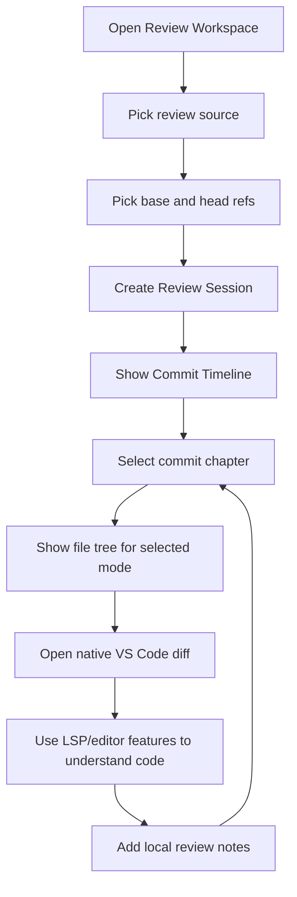

# Review Workspace — Problem Statement and Proposed VS Code UX

> Working name: **Review Workspace**
>
> Product shape: a local-first, provider-agnostic code review workspace inside VS Code.

---

## 1. Problem Statement

Code review is currently too tied to the provider where the pull request happens to live.

A reviewer may receive work through GitHub, Azure DevOps, Bitbucket, or a local branch. Each provider has a different UI, but the actual review task is the same: understand what changed, why it changed, and whether the resulting behavior is correct.

Provider review UIs are good at showing diffs and collecting comments, but they are weak at helping a developer build a deep mental model of a change. Reviewers often need to leave the provider UI and open the branch locally because the editor provides the missing context:

- Go to Definition
- Find References
- Hover/type information
- Symbol navigation
- Project search
- Editing while reviewing
- Syntax-highlighted side-by-side diffs
- Familiar keyboard navigation

The core problem is not simply “Git UI.”

The core problem is:

> Code review needs a local, language-aware workspace that helps the reviewer understand a change as a story, regardless of which provider hosts the PR.

---

## 2. Core Insight

The review workflow being designed here is **change-first**, not file-first.

The reviewer does not primarily think:

```txt
Here are 18 modified files.
```

They think:

```txt
What behavior changed?
How did the work evolve?
Which files participate in that behavior?
Are the tests proving the right thing?
Can I follow the code path from entry point to effect?
```

Commits are useful, but not because each commit is necessarily reviewed as an independent approval unit.

Instead:

> Commits act as chapters in the story of the final change.

The tool should let the reviewer step through the commits to understand how the final solution came together.

---

## 3. Target User

This tool is for a developer who:

- Reviews code across multiple providers.
- Often pulls branches locally to understand the work properly.
- Uses commits as a “story mode” to understand the final change.
- Wants native editor navigation while reviewing diffs.
- Wants side-by-side syntax-highlighted diffs.
- Wants to step around files as the commit timeline advances.
- Wants review notes/checklists, but not a heavy process tool.
- Does not want the tool to police commit quality or enforce process.

---

## 4. Product Definition

### One-line product definition

> A provider-agnostic VS Code extension for reviewing changes locally, using commits as story navigation and VS Code’s editor/LSP features for deep code understanding.

// idk if commits as story navigation is the main selling point. but it is a first class citizen to be able to step through commits.

### What it is

- A local code review workspace.
- A Git-backed change explorer.
- A commit timeline navigator.
- A native VS Code diff launcher.
- A place to keep review notes while understanding a change.
- A provider-agnostic abstraction over GitHub, Azure DevOps, Bitbucket, and local branches.

### What it is not, for MVP

- Not a replacement for GitHub/Azure/Bitbucket PR pages.
- Not a full Git client.
- Not an AI reviewer.
- Not a commit-quality coach.
- Not a commit-message generator.
- Not a team collaboration/comment sync tool.
- Not a merge queue or approval workflow.

---

## 5. Review Session Mental Model

A **Review Session** is the main domain object.

```txt
Review Session
= repository root
+ base ref
+ head ref
+ provider metadata, optional
+ commit timeline
+ file changes
+ review notes
+ current review position
```

Example:

```txt
Review Session
Repository: zulzi-mobile
Source: GitHub PR #4821, optional
Base: main
Head: feature/auth-refresh
Range: main...feature/auth-refresh
```

The provider is optional. The same session should work for:

```txt
Local branch: main...feature/auth-refresh
GitHub PR:    owner/repo#123
Azure PR:     project/repo PR 456
Bitbucket PR: workspace/repo PR 789
```

The review engine should care mostly about Git refs and commits. Provider adapters can be layered on later.

---

## 6. Core UX Principle: Story Mode

The reviewer wants to step through the change over time.

This suggests two related but distinct diff modes:

### 6.1 Commit Delta Mode

Shows only what changed in the selected commit.

```txt
Commit 3 / 7
"Wire refresh token into login flow"

Files changed in this commit:
- src/auth/store.ts
- src/screens/LoginScreen.tsx
```

Use when the reviewer wants to understand what a specific commit introduced.

### 6.2 Cumulative Story Mode

Shows the total change from the base branch up to the selected commit.

```txt
Base: main
Current story point: commit 3 / 7

Files changed so far:
- src/api/auth.ts
- src/auth/store.ts
- src/screens/LoginScreen.tsx
```

Use when the reviewer wants to see how the feature is growing as the story progresses.

This mode is likely very important. It matches the desire to “step through commits and view the file tree as time goes.”

### 6.3 Final Change Mode

Shows the full base-to-head review range.

```txt
main...feature/auth-refresh

All changed files:
- src/api/auth.ts
- src/auth/store.ts
- src/screens/LoginScreen.tsx
- src/auth/store.test.ts
```

Use when the reviewer wants to evaluate the final state.

---

## 7. Proposed MVP UX

### 7.1 High-level flow



### 7.2 MVP screen structure

```txt
┌──────────────────────────────────────────────────────────────────────────────┐
│ VS Code Workbench                                                            │
├──────┬───────────────────────────┬───────────────────────────────────────────┤
│      │ REVIEW WORKSPACE          │ src/auth/store.ts                         │
│ ACT  │                           │ Side-by-side native VS Code diff          │
│ BAR  │ main...feature/auth       │                                           │
│      │                           │ ┌──────────────────┬──────────────────┐  │
│  📁  │ Mode: Cumulative Story    │ │ base             │ │ selected commit │  │
│  🔎  │ Commit: 3 / 7             │ │                  │ │                 │  │
│  🌿  │                           │ │ - old code       │ │ + new code      │  │
│  ✅  │ ▼ Timeline                │ │                  │ │                 │  │
│      │   ✓ 1 Add endpoint        │ └──────────────────┴──────────────────┘  │
│      │   ✓ 2 Add auth store      │                                           │
│      │   ● 3 Wire login flow     │ Hover / Go to Definition / Find Refs       │
│      │   ○ 4 Add tests           │ available through VS Code editor features  │
│      │                           │                                           │
│      │ ▼ Files at this point     │                                           │
│      │   M src/auth/store.ts     │                                           │
│      │   M src/screens/Login.tsx │                                           │
│      │                           │                                           │
│      │ ▼ Notes                   │                                           │
│      │   ? Retry behavior        │                                           │
│      │   ! Missing edge case     │                                           │
├──────┴───────────────────────────┴───────────────────────────────────────────┤
│ Status Bar: Review main...feature/auth · Commit 3/7 · 2 notes · Story Mode   │
└──────────────────────────────────────────────────────────────────────────────┘
```

---

## 8. Recommended VS Code UI Primitives

| UX need | VS Code primitive | Why this fits | Docs |
|---|---|---|---|
| Dedicated entry point for the extension | Activity Bar View Container | Gives the tool a first-class workbench home without becoming a separate app | [Activity Bar UX Guidelines](https://code.visualstudio.com/api/ux-guidelines/activity-bar) |
| Main sidebar layout | Views inside a View Container | Keeps review UI consistent with VS Code’s sidebar model | [Views UX Guidelines](https://code.visualstudio.com/api/ux-guidelines/views), [Sidebars UX Guidelines](https://code.visualstudio.com/api/ux-guidelines/sidebars) |
| Commit timeline and file tree | Tree View | Natural fit for hierarchical data: session → commits → files → notes | [Tree View API](https://code.visualstudio.com/api/extension-guides/tree-view) |
| Opening a review session | Command Palette + Quick Picks | Good for command-driven workflows: “Open Review Session”, then choose source/base/head | [Command Palette UX Guidelines](https://code.visualstudio.com/api/ux-guidelines/command-palette), [Quick Picks UX Guidelines](https://code.visualstudio.com/api/ux-guidelines/quick-picks) |
| Side-by-side file comparison | Native Diff Editor via `vscode.diff` | Highest leverage decision. Reuses VS Code’s editor, syntax highlighting, theme, navigation, and familiar diff UX | [Built-in Commands: `vscode.diff`](https://code.visualstudio.com/api/references/commands) |
| Showing historical file content | Virtual Documents / custom URI scheme | Allows the extension to expose file content from a commit/blob as a document | [Virtual Documents](https://code.visualstudio.com/api/extension-guides/virtual-documents) |
| Editor-native language intelligence | Existing language features / LSP | The whole point of building inside VS Code is reusing hover, definition, references, and diagnostics where available | [Language Extensions Overview](https://code.visualstudio.com/api/language-extensions/overview), [Language Server Extension Guide](https://code.visualstudio.com/api/language-extensions/language-server-extension-guide) |
| Lightweight review progress | Status Bar item | Good for showing current review range, mode, commit position, and note count | [Status Bar UX Guidelines](https://code.visualstudio.com/api/ux-guidelines/status-bar) |
| Rich notes/dashboard, later | Webview View | Useful later for custom review dashboard, note management, and semantic summaries | [Webview API](https://code.visualstudio.com/api/extension-guides/webview), [Webviews UX Guidelines](https://code.visualstudio.com/api/ux-guidelines/webviews) |
| Full custom review workspace, later | Custom Editor | Possible future direction if native sidebar + diff editor becomes too limiting | [Custom Editor API](https://code.visualstudio.com/api/extension-guides/custom-editors) |
| Optional Git/staging integration, later | Source Control API | Useful only if the tool grows into staging/amend/source-control workflows | [Source Control API](https://code.visualstudio.com/api/extension-guides/scm-provider) |
| Inline metadata, later | Text editor decorations | Can annotate diffs with commit/chapter metadata or local note markers | [VS Code API Reference](https://code.visualstudio.com/api/references/vscode-api) |

---

## 9. Proposed UI Architecture

### 9.1 MVP architecture: native-first

```txt
Extension entry point
└── Activity Bar: Review
    └── Review View Container
        ├── Session Summary View       Tree View
        ├── Commit Timeline View       Tree View
        ├── Files View                 Tree View
        └── Notes View                 Tree View or simple Webview View

Editor area
└── Native VS Code Diff Editor
    ├── Left URI:  reviewfs://base-or-parent/path/to/file.ts
    └── Right URI: file:// or reviewfs://selected-commit/path/to/file.ts
```

The MVP should avoid a fully custom web UI. The win is that VS Code already has the editor, diff view, syntax highlighting, and language navigation.

### 9.2 Future architecture: dashboard-enhanced

```txt
Extension entry point
└── Activity Bar: Review
    └── Review View Container
        ├── Timeline Tree View
        ├── Files Tree View
        └── Review Dashboard Webview View

Editor area
├── Native Diff Editors
└── Optional Custom Review Editor
```

The dashboard can show richer concepts later:

- Review checklist
- Behavior areas touched
- Test coverage hints
- Notes grouped by file/symbol
- Provider export status
- Current story position

---

## 10. Detailed UX Designs

### 10.1 Open Review Session command

VS Code command:

```txt
Review Workspace: Open Review Session
```

Quick Pick design:

```txt
┌──────────────────────────────────────────────────────────┐
│ Open Review Session                                      │
├──────────────────────────────────────────────────────────┤
│ Where is the change coming from?                         │
│                                                          │
│  $(git-branch) Local branches                            │
│      Compare two refs in the current repository          │
│                                                          │
│  $(github) GitHub Pull Request                           │
│      Import PR metadata, then review locally             │
│                                                          │
│  $(cloud) Azure DevOps Pull Request                      │
│      Import PR metadata, then review locally             │
│                                                          │
│  $(repo) Bitbucket Pull Request                          │
│      Import PR metadata, then review locally             │
└──────────────────────────────────────────────────────────┘
```

For MVP, only “Local branches” needs to work.

Second step:

```txt
┌──────────────────────────────────────────────────────────┐
│ Open Review Session · 2/3                                │
├──────────────────────────────────────────────────────────┤
│ Select base ref                                          │
│                                                          │
│  main                                                    │
│  develop                                                 │
│  release/2026-06                                         │
└──────────────────────────────────────────────────────────┘
```

Third step:

```txt
┌──────────────────────────────────────────────────────────┐
│ Open Review Session · 3/3                                │
├──────────────────────────────────────────────────────────┤
│ Select head ref                                          │
│                                                          │
│  feature/auth-refresh                                    │
│  fix/checkout-cache                                      │
│  spike/new-module-api                                    │
└──────────────────────────────────────────────────────────┘
```

### 10.2 Activity Bar + Review sidebar

```txt
┌──────┬──────────────────────────────────┐
│      │ REVIEW WORKSPACE                 │
│  📁  │                                  │
│  🔎  │ main...feature/auth-refresh      │
│  🌿  │ 7 commits · 14 files · 2 notes   │
│  ✅  │                                  │
│      │ [Story Mode: Cumulative ▼]       │
│      │                                  │
│      │ SESSION                          │
│      │   Base: main                     │
│      │   Head: feature/auth-refresh     │
│      │   Provider: Local                │
│      │                                  │
│      │ TIMELINE                         │
│      │   ✓ 1  Add refresh endpoint      │
│      │   ✓ 2  Add auth store            │
│      │   ● 3  Wire login flow           │
│      │   ○ 4  Add tests                 │
│      │   ○ 5  Clean up types            │
│      │                                  │
│      │ FILES AT COMMIT 3                │
│      │   M src/auth/store.ts            │
│      │   M src/screens/LoginScreen.tsx  │
│      │   A src/auth/refresh.ts          │
│      │                                  │
│      │ NOTES                            │
│      │   ? Why retry twice?             │
│      │   ! Missing expired-token test   │
└──────┴──────────────────────────────────┘
```

### 10.3 Commit timeline view

The timeline is the core “story mode” surface.

```txt
TIMELINE

✓ 1  7c91a2d  Add refresh endpoint
     2 files · api/auth.ts, types.ts

✓ 2  0ba82cc  Add auth store
     3 files · store.ts, selectors.ts, tests

● 3  e33891f  Wire login flow
     2 files · LoginScreen.tsx, store.ts

○ 4  a3ff901  Add expired token test
     1 file · auth.test.ts
```

Suggested interactions:

| Action | Result |
|---|---|
| Click commit | Set current story point |
| `j` / `k` | Next / previous commit |
| `Enter` on commit | Expand changed files |
| `Space` on commit | Mark chapter as understood |
| Toggle mode | Switch between Commit Delta, Cumulative Story, Final Change |

### 10.4 File tree view

File tree should change depending on review mode.

#### Commit Delta Mode

```txt
FILES IN SELECTED COMMIT

M src/auth/store.ts
M src/screens/LoginScreen.tsx
```

#### Cumulative Story Mode

```txt
FILES CHANGED SO FAR

A src/api/auth.ts
M src/auth/store.ts
M src/screens/LoginScreen.tsx
```

#### Final Change Mode

```txt
ALL FILES IN REVIEW

A src/api/auth.ts
M src/auth/store.ts
M src/screens/LoginScreen.tsx
A src/auth/store.test.ts
M src/types/auth.ts
```

### 10.5 Native diff editor

Clicking a file opens a native VS Code diff.

```txt
┌────────────────────────────────────────────────────────────────────────────┐
│ store.ts ↔ store.ts                                                        │
├────────────────────────────────────┬───────────────────────────────────────┤
│ base / parent                      │ current story point                   │
├────────────────────────────────────┼───────────────────────────────────────┤
│ export const login = async () => {  │ export const login = async () => {    │
│   const token = await api.login()   │   const token = await api.login()     │
│                                    │   await refreshStore.prime(token)     │
│   return token                     │   return token                        │
│ }                                  │ }                                     │
└────────────────────────────────────┴───────────────────────────────────────┘
```

Important implementation note:

- For the right side, prefer real workspace `file://` URIs when showing final/current working state.
- For historical commit content, use virtual documents.
- LSP support may be stronger on real workspace files than on virtual documents, so the MVP should test hover/go-to-definition behavior carefully in diff editors.

### 10.6 Review notes view

Keep notes local and lightweight.

```txt
NOTES

? Retry behavior
  src/auth/store.ts
  Why do we retry refresh twice here?

! Missing test
  src/auth/store.test.ts
  Need expired token coverage.

✓ Checked API usage
  src/api/auth.ts
  Confirmed call sites only use refreshed token path.
```

MVP note scopes:

```txt
Session-level note
File-level note
```

Later note scopes:

```txt
Line-level note
Symbol-level note
Commit-level note
Change-group-level note
```

Line-level notes mean “attach this note to this exact changed line,” similar to PR comments in GitHub/Azure/Bitbucket. That can wait. For this product, session/file notes may be enough initially.

### 10.7 Status Bar

```txt
Review: main...feature/auth · Story 3/7 · Cumulative · 2 notes
```

Status bar item behavior:

- Click opens Review Workspace sidebar.
- Tooltip shows base/head/current commit.
- Avoid multiple status bar items.

---

## 11. User Journey

### 11.1 Start a review

1. User runs `Review Workspace: Open Review Session`.
2. User chooses local branches.
3. User picks base ref.
4. User picks head ref.
5. Review sidebar opens.
6. Timeline is populated.
7. First commit is selected.

### 11.2 Understand the story

1. User steps through commits.
2. File tree updates as the current story point changes.
3. User opens diffs from the file tree.
4. User uses VS Code editor features to inspect code.
5. User marks commits/files as understood.

### 11.3 Investigate behavior

1. User sees suspicious changed code.
2. User hovers to inspect types.
3. User goes to definition or references.
4. User opens the implementation in a normal editor tab.
5. User jumps back to the diff.
6. User leaves a local note.

### 11.4 Finish review

1. User reaches final commit.
2. User switches to Final Change Mode.
3. User scans all files in the final diff.
4. User reviews notes.
5. User returns to provider UI to leave final comments/approval manually.

---

## 12. Data Model Sketch

```ts
export type ReviewProvider =
  | { type: "local" }
  | { type: "github"; owner: string; repo: string; pullRequestNumber: number }
  | { type: "azure"; organization: string; project: string; repository: string; pullRequestId: number }
  | { type: "bitbucket"; workspace: string; repo: string; pullRequestId: number };

export interface ReviewSession {
  id: string;
  repositoryRoot: string;
  provider: ReviewProvider;
  baseRef: string;
  headRef: string;
  currentCommitSha?: string;
  mode: ReviewMode;
  commits: ReviewCommit[];
  notes: ReviewNote[];
}

export type ReviewMode =
  | "commit-delta"
  | "cumulative-story"
  | "final-change";

export interface ReviewCommit {
  sha: string;
  shortSha: string;
  subject: string;
  authorName: string;
  authorDate: string;
  parentSha?: string;
  changedFiles: ReviewFileChange[];
}

export interface ReviewFileChange {
  path: string;
  status: "added" | "modified" | "deleted" | "renamed";
  oldPath?: string;
}

export interface ReviewNote {
  id: string;
  body: string;
  status: "open" | "resolved";
  severity?: "question" | "concern" | "note";
  scope: ReviewNoteScope;
  createdAt: string;
}

export type ReviewNoteScope =
  | { type: "session" }
  | { type: "file"; path: string }
  | { type: "commit"; sha: string }
  | { type: "line"; path: string; line: number; side: "left" | "right" }
  | { type: "symbol"; path: string; symbolName: string };
```

---

## 13. Command Sketch

```txt
Review Workspace: Open Review Session
Review Workspace: Close Review Session
Review Workspace: Next Commit
Review Workspace: Previous Commit
Review Workspace: Toggle Review Mode
Review Workspace: Open Selected File Diff
Review Workspace: Mark Commit Understood
Review Workspace: Mark File Reviewed
Review Workspace: Add Note
Review Workspace: Show Final Change
```

Possible keyboard shortcuts:

```json
[
  {
    "command": "reviewWorkspace.nextCommit",
    "key": "j",
    "when": "reviewWorkspaceFocus"
  },
  {
    "command": "reviewWorkspace.previousCommit",
    "key": "k",
    "when": "reviewWorkspaceFocus"
  },
  {
    "command": "reviewWorkspace.openSelectedFileDiff",
    "key": "enter",
    "when": "reviewWorkspaceFocus"
  }
]
```

---

## 14. Extension Contribution Sketch

Example `package.json` shape:

```json
{
  "contributes": {
    "commands": [
      {
        "command": "reviewWorkspace.openSession",
        "title": "Open Review Session",
        "category": "Review Workspace"
      },
      {
        "command": "reviewWorkspace.nextCommit",
        "title": "Next Commit",
        "category": "Review Workspace"
      },
      {
        "command": "reviewWorkspace.previousCommit",
        "title": "Previous Commit",
        "category": "Review Workspace"
      }
    ],
    "viewsContainers": {
      "activitybar": [
        {
          "id": "reviewWorkspace",
          "title": "Review",
          "icon": "resources/review.svg"
        }
      ]
    },
    "views": {
      "reviewWorkspace": [
        {
          "id": "reviewWorkspace.timeline",
          "name": "Timeline"
        },
        {
          "id": "reviewWorkspace.files",
          "name": "Files"
        },
        {
          "id": "reviewWorkspace.notes",
          "name": "Notes"
        }
      ]
    }
  }
}
```

---

## 15. Implementation Notes

### 15.1 Git data source

MVP can use the Git CLI directly.

Useful commands:

```bash
git merge-base main feature/auth-refresh
git log --reverse --format="%H%x00%h%x00%s%x00%an%x00%aI" main..feature/auth-refresh
git diff --name-status <parent> <commit>
git show <commit>:path/to/file.ts
git diff --name-status main...feature/auth-refresh
```

### 15.2 Opening native diffs

Use VS Code’s built-in diff command:

```ts
await vscode.commands.executeCommand(
  "vscode.diff",
  leftUri,
  rightUri,
  "store.ts: main ↔ commit 3"
);
```

### 15.3 Virtual document scheme

Historical file contents can be exposed through a custom URI scheme:

```txt
reviewfs://<session-id>/<commit-sha>/src/auth/store.ts
```

The extension’s content provider resolves that URI by reading the file from Git:

```bash
git show <commit-sha>:src/auth/store.ts
```

### 15.4 LSP caution

The main product bet is editor-native language intelligence.

However, virtual documents may not behave exactly like real workspace files for every language extension. The MVP needs to test:

- Hover on right side of diff
- Go to Definition from right side of diff
- Find References from right side of diff
- Hover/go-to-definition from historical left side
- Whether TypeScript/React Native project context is preserved

If virtual documents reduce LSP quality too much, the extension should prefer:

- Native workspace file on the right side.
- Virtual/historical file only on the left side.
- A command to open the current file normally for deeper navigation.

---

## 16. MVP Build Plan

### Milestone 1 — Local branch review

- Add Activity Bar item.
- Add Review View Container.
- Add command: `Open Review Session`.
- Let user choose base/head refs through Quick Pick.
- Build commit timeline from Git CLI.
- Render commit timeline as Tree View.

### Milestone 2 — File tree and native diffs

- On commit selection, compute changed files.
- Render files in Tree View.
- On file selection, open native diff with `vscode.diff`.
- Support Commit Delta Mode.

### Milestone 3 — Cumulative Story Mode

- Add mode switch.
- Compute diff from base to selected commit.
- Update file tree as the story advances.
- Update status bar with current story position.

### Milestone 4 — Notes

- Add local notes store.
- Support session-level and file-level notes.
- Display notes in sidebar.
- Persist notes in `.vscode/review-workspace/` or extension global storage.

### Milestone 5 — Provider adapters

- Add GitHub PR import.
- Add Azure DevOps PR import.
- Add Bitbucket PR import.
- Normalize all providers into `ReviewSession`.

Provider export/comment sync should remain out of scope until local review workflow feels good.

---

## 17. Key Risks

### 17.1 LSP inside diffs may be uneven

The right side of a diff against a real workspace file is likely the safest place to expect language features. Historical/virtual documents may have weaker support depending on the language extension.

### 17.2 Too much custom UI too early

A Webview dashboard or Custom Editor could make the tool feel polished, but it risks rebuilding VS Code instead of using it.

The MVP should stay native-first.

### 17.3 Provider integrations can distract from the core workflow

Provider adapters are valuable, but the core value is local understanding. Start with local branch review first.

### 17.4 Review notes can become a second PR system

Avoid syncing, threading, resolving, and exporting comments in the MVP. Local notes are enough to validate the product.

---

## 18. Open Questions

1. Is **Cumulative Story Mode** more important than Commit Delta Mode?
2. Should the file tree default to “files changed in current commit” or “files changed so far”?
3. Should review progress be tracked per commit, per file, or both?
4. Are local review notes enough, or does the tool need provider comment export soon?
5. How much LSP functionality survives in native diff editors with virtual documents?
6. Should the notes UI be a Tree View first, or a Webview View from day one?
7. Should staging/amending remain completely separate, or should LazyGit-style amend workflows be added later?

---

## 19. Recommended First Prototype

Build this first:

```txt
Activity Bar item
→ Review sidebar
→ Open Review Session command
→ Base/head Quick Pick
→ Commit Timeline Tree View
→ Files Tree View
→ Native VS Code diff editor
→ Commit Delta Mode
```

Then add:

```txt
Cumulative Story Mode
→ Status Bar context
→ Local notes
→ Provider import
```

Do not start with:

```txt
Custom Editor
Webview dashboard
Provider comment sync
AI review
Commit quality tooling
```

The first prototype should answer one question:

> Does stepping through commits as a story, while opening native VS Code diffs with editor/LSP features, feel materially better than reviewing in GitHub/Azure/Bitbucket or LazyGit alone?

---

## 20. Reference Links

Official VS Code docs used for this design:

- [Activity Bar UX Guidelines](https://code.visualstudio.com/api/ux-guidelines/activity-bar)
- [Sidebars UX Guidelines](https://code.visualstudio.com/api/ux-guidelines/sidebars)
- [Views UX Guidelines](https://code.visualstudio.com/api/ux-guidelines/views)
- [Tree View API](https://code.visualstudio.com/api/extension-guides/tree-view)
- [Command Palette UX Guidelines](https://code.visualstudio.com/api/ux-guidelines/command-palette)
- [Quick Picks UX Guidelines](https://code.visualstudio.com/api/ux-guidelines/quick-picks)
- [Built-in Commands: `vscode.diff`](https://code.visualstudio.com/api/references/commands)
- [Virtual Documents](https://code.visualstudio.com/api/extension-guides/virtual-documents)
- [Language Extensions Overview](https://code.visualstudio.com/api/language-extensions/overview)
- [Language Server Extension Guide](https://code.visualstudio.com/api/language-extensions/language-server-extension-guide)
- [Status Bar UX Guidelines](https://code.visualstudio.com/api/ux-guidelines/status-bar)
- [Webview API](https://code.visualstudio.com/api/extension-guides/webview)
- [Webviews UX Guidelines](https://code.visualstudio.com/api/ux-guidelines/webviews)
- [Custom Editor API](https://code.visualstudio.com/api/extension-guides/custom-editors)
- [Source Control API](https://code.visualstudio.com/api/extension-guides/scm-provider)
- [VS Code API Reference](https://code.visualstudio.com/api/references/vscode-api)
